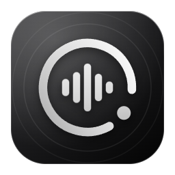

<p align="center"></p>

# Sonara

A desktop music player in liquid glass for **Windows, macOS and Linux**: YouTube Music, plus your own lossless files and Subsonic server, with synced lyrics, a live waveform and a look you can make your own.

Sonara is based on [Obsidian Music for PC](#credits-and-licence) and builds on it with a new design, player and customisation.

## Download

Get the latest version from **[Releases](../../releases/latest)**.

| System | File |
|---|---|
| Windows, any PC (picks x64 or ARM64 itself) | `Sonara-Setup-<version>.exe` |
| Windows (most PCs, Intel/AMD) | `Sonara-Setup-<version>-x64.exe` (installer) or `Sonara-<version>-x64-portable.zip` |
| Windows on ARM (Snapdragon) | `Sonara-Setup-<version>-arm64.exe` or `Sonara-<version>-arm64-portable.zip` |
| macOS, Apple Silicon (M1 and later) | `Sonara-<version>-mac-arm64.dmg` |
| macOS, Intel | `Sonara-<version>-mac-x64.dmg` |
| Linux x64 | `Sonara-<version>-linux-x86_64.AppImage` or `Sonara-<version>-linux-amd64.deb` |
| Linux ARM64 | `Sonara-<version>-linux-arm64.AppImage` or `Sonara-<version>-linux-arm64.deb` |

`SHA256SUMS.txt` in each release lists every file's checksum.

**First open.** The builds aren't signed with paid certificates, so:

- **Windows:** if SmartScreen warns, choose **More info › Run anyway**. The installer installs for your user only (no admin needed).
- **macOS:** drag Sonara to Applications, then **right-click it › Open › Open** the first time. If macOS says it's damaged, run `xattr -cr /Applications/Sonara.app` in Terminal.
- **Linux:** make the AppImage executable (`chmod +x Sonara-*.AppImage`) and run it, or install the .deb (`sudo apt install ./Sonara-*.deb`).

## Features

- **Pebble player.** The player rests as a small glass pebble with a live, audio-reactive waveform and opens into the full controls when you point at it.
- **Full-screen player** over the artwork's colours, with word-by-word synced lyrics and Up Next beside it.
- **Lyrics tools:** pronunciation in Latin letters (Indian scripts offline) and translation into many languages.
- **Liquid glass everywhere,** with real refraction on floating controls; Clear or Tinted glass and adjustable blur.
- **Make it yours:** 7 themes, any accent (or the playing song's colours), app font, corner roundness, page background, cover size and row height, all with precise sliders and a live preview before you apply.
- **Waveform options:** colour (from the song by default), bars, thickness, height, sensitivity, auto level, smoothness, shape and style.
- **Your music:** lossless FLAC/WAV folders and Subsonic servers (Navidrome, Gonic, Airsonic…), plus "Lossless when available" for YouTube songs you own.
- **Downloads** for offline listening, liked songs, playlists, YouTube playlist import, Spotify import (playlists, albums and songs, matched on YouTube Music), Recently Played (remove any song from it), sleep timer, crossfade, a 10-band equalizer, and media keys.
- **Search as you type:** suggested searches plus the songs, artists and albums they mean; click a song to play it.
- **Update notices** when a new Sonara is released (Settings › About).
- **Spatial Audio:** virtual speakers around you for headphones, or a wider stage for speakers (Settings › Playback).
- **Control it from any app:** a floating mini player that stays on top of other windows whenever you're using another app (or only when Sonara is minimised, or never): previous / play-pause / next, seeking on its progress line, and Up Next (songs you queue play before suggestions); double-click it to open Sonara. System-wide shortcuts: Ctrl + Alt + Space or P (play / pause), → / ← (next / previous), ↑ / ↓ (volume), L (like) and M (mini player); ⌘ instead of Ctrl on a Mac.
- **A welcome guide** on first launch; every keyboard shortcut is listed in Settings › About.

## Build from source

Node.js 22 or later:

```bash
npm install
npm run dev                 # development, with hot reload
npm run typecheck
npx electron-vite build && npx electron-builder --win --x64 --arm64   # Windows installers and zips
npx electron-vite build && npx electron-builder --mac --arm64 --x64   # macOS .dmg (on a Mac)
npx electron-vite build && npx electron-builder --linux --x64 --arm64 # Linux AppImage and .deb
```

Releases are built by [GitHub Actions](.github/workflows/release.yml) on Windows, macOS and Linux whenever a version tag is pushed:

```bash
git tag v2.0.2
git push origin v2.0.2
```

## How it works

```
src/main/        Electron main process
  youtube.ts     YouTube Music through YouTube.js: home, search, albums, artists,
                 playlists, radio, lyrics, playlist import
  stream.ts      Stream resolver and the ytstream:// protocol
  library.ts     Local music folders: scanning, index, artwork
  subsonic.ts    Self-hosted server client (Subsonic API, token auth)
  lossless.ts    Matches YouTube songs to your lossless copies
  media.ts       media:// protocol: local files and server songs, byte ranges
  store.ts       library.json: liked songs, playlists, history, settings
  index.ts       Window, app:// protocol, IPC, taskbar buttons, tray
src/preload/     The typed bridge between the window and the main process
src/renderer/    React UI (Tailwind v4, Zustand, TanStack Query)
  state/player.ts    Queue and audio engine (two decks: gapless, crossfade)
  lib/waveform.ts    The waveform's analyser (listens only; playback is untouched)
```

Your library stays on your computer, in the app's data folder (`%APPDATA%\Obsidian Music` on Windows, the folder Sonara has always used, so existing libraries carry over).

## Credits and licence

- Based on **Obsidian Music for PC** by Alby Mathew Biju (GPL-3.0-or-later), itself inspired by [Obsidian Music](https://github.com/Varun7009/Obsidian-Music) by Varun7009 and designed after [BitChord](https://github.com/kushagrasinghx/BitChord) by kushagrasinghx (GPL-3.0).
- Design language: Apple's [Liquid Glass](https://developer.apple.com/documentation/TechnologyOverviews/liquid-glass) and Human Interface Guidelines.
- [Inter](https://rsms.me/inter/) (OFL), [YouTube.js](https://github.com/LuanRT/YouTube.js) (MIT), [am-lyrics](https://github.com/uimaxbai/am-lyrics) (MPL-2.0) and [music-metadata](https://github.com/Borewit/music-metadata) (MIT).

Sonara is free software under the **GNU General Public License v3.0 or later**; see [LICENSE](LICENSE).

Not affiliated with YouTube, Google, Apple, Obsidian Music or BitChord. Streaming from YouTube outside its official apps goes against YouTube's Terms of Service. Use it at your own discretion and in line with your local laws.
